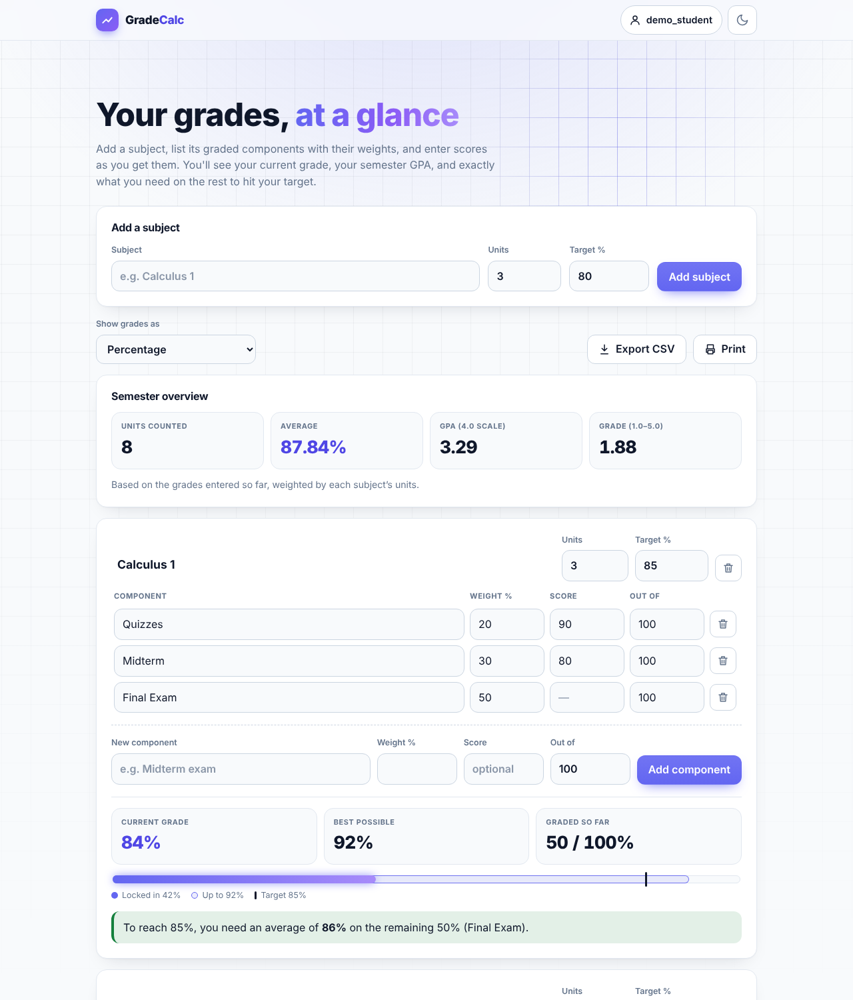
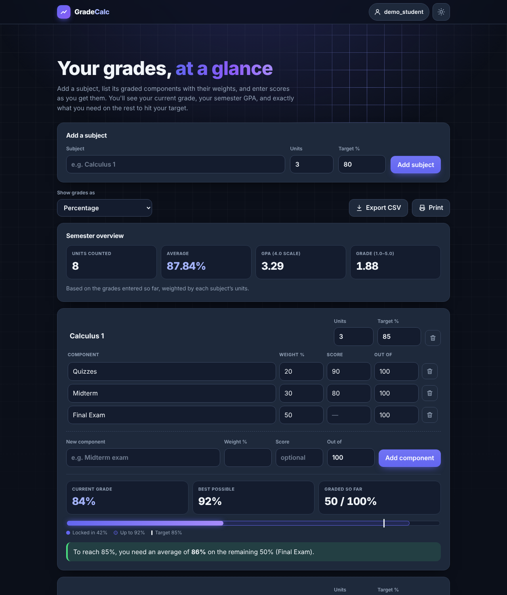
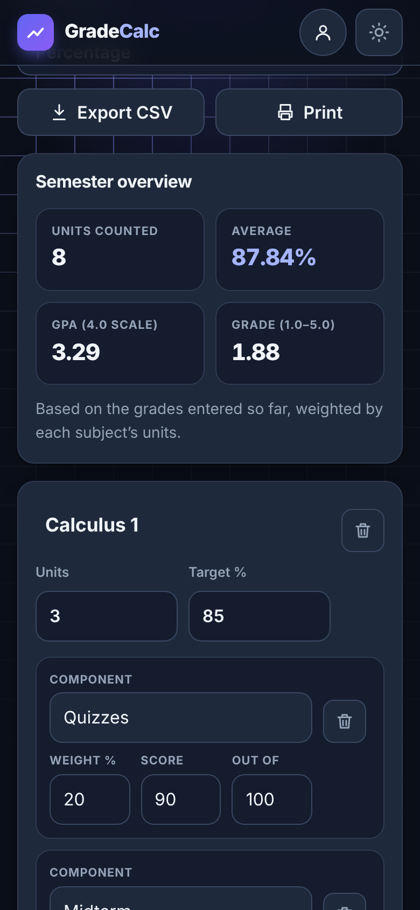

# Grade Calculator

A mobile-first web app for students. Add your subjects, list each graded component (quizzes, midterm, final…) with its weight, and enter scores as you get them. It shows your **current grade**, your **semester GPA**, and tells you **what average you need on the rest** to hit your target.

| Light | Dark |
| --- | --- |
|  |  |

<p align="center"></p>

## Features

**Grades**
- Multiple subjects, each with its own target grade and credit units
- Weighted components with scores and custom "out of" values (e.g. 45/50)
- Live results: current grade, best possible grade, and a progress meter showing what's locked in, what's still possible, and where your target sits
- "What do I need?" calculator: the average required on ungraded work to reach your target, or a clear message if the target is already secured or out of reach
- Warns when your weights don't add up to 100%
- View grades as a percentage, US letter/GPA (4.0), or a 1.0–5.0 scale (preference is remembered)

**Semester GPA**
- Weighted by each subject's credit units: average %, GPA on the 4.0 scale, and grade on the 1.0–5.0 scale
- Based on the grades entered so far; subjects with nothing graded yet are left out and the app tells you

**Export**
- **Export CSV**: every component, a per-subject summary, and the semester totals (opens cleanly in Excel and Google Sheets)
- **Print**: a clean black-and-white report, with controls and background hidden

**Accounts**
- Sign up and log in; each student sees only their own subjects
- Change password (signs out your other devices) and delete account (removes all your data)

**Design**
- Light and dark mode, using the device setting by default with a toggle that is remembered
- Silhouette grid background with an accent-colored spotlight that follows your cursor (it drifts on its own on touch screens)
- Mobile-first layout: components become stacked cards on phones and a table on larger screens; the account menu is a bottom sheet on phones
- Animations: staggered card entrance, numbers that count up, a progress meter that grows in, and a sun/moon toggle that spins. All of it switches off for people who prefer reduced motion

## Tech stack

| Part      | Choice                                         |
| --------- | ---------------------------------------------- |
| Front end | HTML, CSS, vanilla JavaScript                  |
| Back end  | Node.js (built-in `http` module, REST API)     |
| Database  | SQLite via Node's built-in `node:sqlite`       |
| Tests     | Node's built-in test runner                    |

There are **no npm dependencies**, so there is nothing to install.

## Getting started

Requires **Node.js 22.13 or newer**.

```bash
git clone <your-repo-url>
cd grade-calculator
npm start
```

Then open <http://localhost:3000>. Set a different port with `PORT=8080 npm start`.

## Running the tests

```bash
npm test
```

## How the math works

Each component has a weight `w` (percent of the final grade) and a score `s` out of `m`.

- Points earned so far: `earned = Σ w × (s / m)` over graded components
- Current grade: `earned / gradedWeight × 100`
- Needed on the rest: `(target / 100 × totalWeight − earned) / remainingWeight × 100`

If the needed average is 0 or less, the target is secured. If it is over 100, it's out of reach.

**Semester GPA:** each subject's current grade is converted to grade points on the chosen scale, then averaged weighted by units: `Σ (points × units) / Σ units`.

The logic lives in [`public/calc.js`](public/calc.js) and is covered by unit tests.

> The letter/GPA and 1.0–5.0 conversion tables are common examples. Schools differ, so edit `US_SCALE` and `PH_SCALE` in `public/calc.js` to match yours.

## API

Account endpoints:

| Method | Endpoint             | Description                                         |
| ------ | -------------------- | --------------------------------------------------- |
| POST   | `/api/register`      | Create an account and log in `{ username, password }` |
| POST   | `/api/login`         | Log in `{ username, password }`                     |
| POST   | `/api/logout`        | Log out (ends the session on the server)            |
| GET    | `/api/me`            | The logged-in user, or 401                          |
| POST   | `/api/password`      | Change password `{ currentPassword, newPassword }`; signs out other devices |
| DELETE | `/api/account`       | Delete the account and all its data `{ password }`  |

Every endpoint below needs a logged-in session and only ever touches that user's own data.

| Method | Endpoint                          | Description                          |
| ------ | --------------------------------- | ------------------------------------ |
| GET    | `/api/subjects`                   | List subjects with their components  |
| POST   | `/api/subjects`                   | Create a subject `{ name, target, units }` |
| PUT    | `/api/subjects/:id`               | Update name, target and/or units     |
| DELETE | `/api/subjects/:id`               | Delete a subject and its components  |
| POST   | `/api/subjects/:id/components`    | Add `{ name, weight, score, maxScore }` |
| PUT    | `/api/components/:id`             | Update a component                   |
| DELETE | `/api/components/:id`             | Delete a component                   |

## Accounts and security

- Passwords are hashed with scrypt and a random salt per user. The plain password is never stored.
- Login sets a random session token in an `HttpOnly`, `SameSite=Lax` cookie (30 days). Only a SHA-256 hash of the token is stored in the database, and logging out deletes it.
- The cookie gets the `Secure` flag automatically when the app is served over HTTPS.
- Every database query is scoped to the logged-in user, so one student can't read or change another's data. This is covered by tests.
- Changing your password or deleting your account asks for the current password again, and wrong guesses are rate limited like failed logins.
- Repeated failed logins for the same username and IP are temporarily blocked, and account creation is limited per IP.
- Wrong username and wrong password give the same error message.
- CSV export neutralizes cells that start with `=`, `+`, `-` or `@`, so a subject named `=SUM(...)` can't run as a spreadsheet formula.

### Upgrading an existing database

The app upgrades older databases automatically on start. Subjects created before credit units existed get the default of 3 units, which you can edit. Nothing is deleted. (If you ran a very early version without accounts, its subjects don't belong to any account and stay hidden. Delete `data.db` to start fresh.)

### Deploying

- Use a host with a persistent disk, since the SQLite file (`data.db`) has to survive restarts. Set `DB_PATH` to a path on that disk.
- Serve it over HTTPS (most hosts do this for you).
- Behind a reverse proxy, set `TRUST_PROXY=1` so rate limiting sees each visitor's real IP.
- Run a single instance, since SQLite is a single file.

## Project structure

```
grade-calculator/
├── server.js        # HTTP server, REST routes, static files
├── db.js            # SQLite setup, schema and upgrades
├── docs/            # README screenshots
├── public/
│   ├── index.html
│   ├── style.css    # design tokens, light/dark themes, mobile-first layout, print styles
│   ├── calc.js      # grade and semester math (shared with tests)
│   ├── app.js       # UI, animations, CSV export, account dialog
│   └── favicon.svg
└── test/
    ├── calc.test.js
    └── api.test.js
```

## Ideas for next steps

- A true "forgot password" flow (needs email)
- Drop-the-lowest-quiz rules
- Multiple semesters, with a cumulative GPA
- Charts of grades over time
